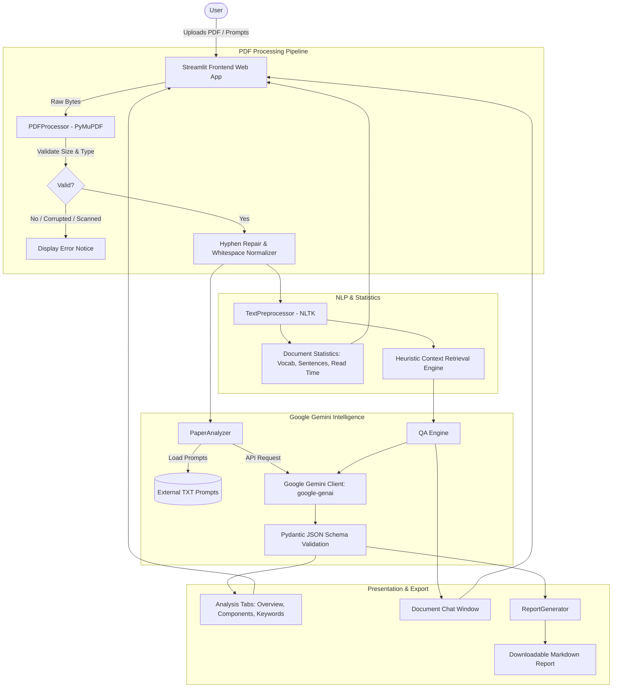

# PaperMind AI — NLP-Based Research Paper Intelligence Assistant

**Academic Level:** Final Year B.Tech in Computer Science and Engineering  
**Primary Domain:** Natural Language Processing (NLP) & Applied Large Language Models (LLMs)  
**Frameworks:** Streamlit, Google Gen AI SDK (`google-genai`), PyMuPDF (`fitz`), NLTK  

---

## 1. Project Overview

**PaperMind AI** is an intelligent academic research assistant designed to accelerate literature review and scientific document comprehension. In academic research, students and scholars often spend countless hours parsing dense, multi-page PDF documents to extract core methodologies, datasets, experimental baselines, and architectural limitations.

PaperMind AI bridges this gap by marrying classical **Natural Language Processing (NLP)** preprocessing techniques with state-of-the-art **Google Gemini 2.5 Flash** generative models. The application extracts digital text from complex two-column academic layouts, performs linguistic tokenization and statistical analysis, structures research components into verifiable insights without hallucinations, and facilitates document-grounded, contextual question answering.

---

## 2. Problem Statement

Modern scientific literature is proliferating exponentially across arXiv, IEEE Xplore, ACM Digital Library, and Springer. Students and researchers face significant challenges:
1. **Information Overload:** Analyzing dozens of 10-to-30-page papers to find specific baseline metrics or datasets is time-consuming.
2. **Dense Technical Jargon:** Identifying whether a paper is relevant to a specific thesis or project requires deep domain comprehension.
3. **Generic AI Hallucinations:** Standard commercial chat assistants frequently hallucinate non-existent benchmarks, incorrect author claims, or fabricated datasets when answering questions without strict document grounding.
4. **Lack of Explainability:** Black-box LLM summaries often omit raw quantitative document metrics (reading time, lexical diversity, token density).

---

## 3. Project Objectives

1. **Automated Multi-Page Text Extraction:** Reliably ingest academic PDF documents, preserving page boundaries while repairing column breaks and hyphenated text using PyMuPDF.
2. **Explainable Linguistic Analysis:** Compute quantitative NLP metrics (word counts, sentence segmentations, unique vocabulary size, reading time estimates) using NLTK.
3. **Structured Research Component Synthesis:** Extract standardized academic sections: Problem Statement, Research Objectives, Methodology, Algorithms/Models, Datasets, Results, Limitations, and Future Scope.
4. **Domain Keyword Extraction:** Isolate up to 10 context-specific technical keywords while filtering out generic academic noise words (e.g., "paper", "study", "method").
5. **Document-Grounded Q&A (Vector-DB-Free):** Enable conversational interaction where answers are strictly derived from document context, explicitly returning *"Not explicitly stated in the paper"* when evidence is absent.
6. **Academic Report Export:** Generate a comprehensive, publication-ready Markdown research report summarizing all findings for thesis documentation.

---

## 4. Key Features

| Feature | Description | Implementation Details |
| :--- | :--- | :--- |
| **PDF Extraction & Validation** | Upload and parse academic PDFs with size and type checks. | PyMuPDF (`fitz`), custom regex hyphenation reconnector, empty/scanned PDF detection. |
| **Linguistic Statistics** | Quantitative NLP metrics on extracted text. | NLTK sentence segmenter, vocabulary diversity metrics, reading time heuristics. |
| **AI Research Summary** | Multi-section overview, contributions, and conclusions. | Google Gen AI Python SDK (`google-genai`), low-temperature generation (`0.2`). |
| **Component Extraction** | Extracts objectives, methods, datasets, limitations, and future work. | Pydantic JSON schema validation with fallback recovery. |
| **Keyword Extraction** | Surfaces top domain-specific technical terminology. | Algorithmic stop-word filtering combined with model extraction. |
| **Document-Grounded Q&A** | Interactive conversational agent with conversational memory. | Heuristic keyword-overlap context retrieval without vector database overhead. |
| **Markdown Report Export** | One-click export of complete analysis and document metrics. | Publication-ready formatted `.md` report generator. |

---

## 5. Technology Stack

- **Programming Language:** Python 3.12+
- **Frontend / Web UI:** Streamlit (`>= 1.35.0`)
- **LLM Engine:** Google Gemini API (`gemini-2.5-flash` / `gemini-1.5-flash`)
- **LLM SDK:** Official Google Gen AI SDK (`google-genai`)
- **PDF Extraction:** PyMuPDF (`fitz` `>= 1.24.0`)
- **NLP & Linguistics:** NLTK (`nltk` `>= 3.8.1`), Regular Expressions
- **Data Validation:** Pydantic v2 (`pydantic` `>= 2.7.0`)
- **Configuration Management:** PyYAML, `python-dotenv`
- **Unit Testing:** PyTest (`pytest` `>= 8.2.0`)

---

## 6. System Architecture



---

## 7. NLP Concepts Used

1. **Text Normalization & Unicode Sanitization:** Standardizes unicode quotes, em-dashes, and typographical ligatures (`fi`, `fl`, `ffi`) common in LaTeX-rendered academic documents.
2. **De-hyphenation:** Recombines hyphenated words broken across newline boundaries due to two-column academic typesetting (e.g., `trans-\nformer` $\to$ `transformer`).
3. **Sentence Segmentation:** Dissects unstructured text streams into grammatically distinct sentences using NLTK's `PunktTokenize` algorithm, with custom regex heuristics protecting common scientific abbreviations (`et al.`, `e.g.`, `Fig.`, `i.e.`).
4. **Lexical Diversity & Statistics:** Analyzes unique token distribution (vocabulary richness), word length distributions, and standard academic reading speed calculations (220 WPM).
5. **Grounded Heuristic Passage Retrieval:** Instead of requiring an external vector database, PaperMind AI segments documents into semantic paragraphs and calculates term frequency relevance and phrase matches with the user's query to dynamically provide context to Gemini.

---

## 8. Folder Structure

```
PaperMind-AI/
├── app.py                     # Streamlit frontend & session state management
├── requirements.txt           # Python dependencies
├── .env.example               # Template for Gemini API credentials
├── .gitignore                 # Files excluded from version control
├── README.md                  # Complete academic documentation
├── config/
│   └── config.yaml            # Model parameters, file limits, and app settings
├── modules/
│   ├── __init__.py            # Module exports
│   ├── pdf_processor.py       # PyMuPDF extraction, validation & chunking
│   ├── text_preprocessor.py   # NLTK sentence splitter, metrics & passage retrieval
│   ├── gemini_client.py       # Official google-genai SDK wrapper & error handling
│   ├── paper_analyzer.py      # Research component extractor & Pydantic parser
│   ├── qa_engine.py           # Document-grounded Q&A logic & conversation memory
│   └── report_generator.py    # Publication-grade Markdown report generator
├── prompts/
│   ├── system_prompt.txt      # Core academic persona & security directives
│   ├── analysis_prompt.txt    # Structured JSON research component schema
│   └── qa_prompt.txt          # Document-grounded question-answering template
├── utils/
│   ├── __init__.py            # Helper exports
│   └── helpers.py             # Config loading, prompt reader, formatting
├── tests/
│   ├── test_pdf_processor.py  # PyTest suite for PDF extraction & error handling
│   └── test_preprocessor.py   # PyTest suite for NLP operations & report generation
└── sample_papers/
    └── README.md              # Guidance on sample arXiv papers for testing
```

---

## 9. Installation Instructions

### Prerequisites
- Python 3.11 or 3.12 (Python 3.12 recommended)
- `pip` package manager
- Google Gemini API Key ([Google AI Studio](https://aistudio.google.com/))

### Step 1: Clone or Navigate to the Repository
```bash
cd /Users/kashyap/Papermind
```

### Step 2: Create and Activate Virtual Environment
```bash
# Create virtual environment
python3.12 -m venv .venv

# Activate on macOS / Linux:
source .venv/bin/activate

# (On Windows, use: .venv\Scripts\activate)
```

### Step 3: Install Required Dependencies
```bash
pip install -r requirements.txt
```

---

## 10. Gemini API Key Setup

1. Sign in to [Google AI Studio](https://aistudio.google.com/) and create a free Gemini API key.
2. Copy `.env.example` to `.env`:
   ```bash
   cp .env.example .env
   ```
3. Open `.env` and add your API key:
   ```env
   GEMINI_API_KEY=AIzaSyYourActualGeminiAPIKeyHere
   ```
*(Note: You can also enter or test the API key directly in the PaperMind AI web interface sidebar).*

---

## 11. Running the Application

Launch the Streamlit web application:
```bash
streamlit run app.py
```

The application will start and automatically open in your default browser at:
```
http://localhost:8501
```

---

## 12. Running Unit Tests

Execute the automated test suite with PyTest:
```bash
pytest -v tests/
```
The test suite validates:
- Multi-page PDF extraction and boundary preservation
- Corrupted file rejection and graceful error handling
- Empty and scanned image-only PDF detection
- NLP sentence segmentation and text normalization
- Context-relevance heuristic matching
- Report generation without hardcoded artifacts

---

## 13. Sample Usage Walkthrough

1. **Sidebar Setup:** Ensure your Gemini API key is configured. The sidebar displays a green connection badge when connected.
2. **Upload Research Paper:** Drag and drop an academic PDF (e.g., Vaswani et al. *"Attention Is All You Need"*).
3. **Inspect Statistics:** Review total pages, word count, sentence count, unique vocabulary, and estimated reading time.
4. **Trigger Analysis:** Click **"🚀 Analyze Research Paper"**. PaperMind AI parses the document and displays:
   - **Overview Tab:** Paper title, problem statement, executive overview, core contributions, and conclusion.
   - **Research Analysis Tab:** Objectives, proposed methodology, algorithms/models, datasets, experimental findings, limitations, and future directions.
   - **Keywords Tab:** Filtered domain-specific keyword badges.
5. **Interactive Q&A:** Navigate to **"Ask Your Paper"** and ask specific questions (e.g., *"Which optimizer was used?"* or click one of the suggested query buttons).
6. **Download Report:** Switch to **"Download Report"** to preview and download the formatted Markdown report (`.md`).

---

## 14. Academic Limitations

- **Scanned / Image-Only PDFs:** PaperMind AI requires digital, selectable text. Scanned photocopies lacking an OCR layer are detected and flagged.
- **Complex Multi-Column Tables:** Complex tabular numerical data in PDFs may experience formatting loss during raw text extraction.
- **LLM Rate Limits:** Free-tier Gemini API keys are subject to Google AI Studio RPM (Requests Per Minute) limits. The client includes automatic rate-limit detection.

---

## 15. Future Enhancements

- **Integrated OCR Engine:** Add Tesseract OCR for automatic fallback processing of scanned historical papers.
- **Interactive Citation Graph:** Visual network representation of referenced literature.
- **Multi-Document Comparative Analysis:** Side-by-side comparison of two competing papers on the same benchmark.
- **LaTeX Math Rendering:** Native rendering of mathematical equations extracted from PDF text.

---

## 16. User Interface Gallery

| View | Description |
| :--- | :--- |
| **Welcome & Guidance** | Clean minimalist landing screen with upload instructions and feature cards. |
| **Document Metrics** | Dynamic counter cards displaying word count, pages, sentences, and reading time. |
| **Structured Analysis** | Two-column academic card view detailing methodology, models, and findings. |
| **Document Chat** | Interactive conversation interface grounded directly in the paper's text. |
| **Report Export** | Publication-grade Markdown summary preview and export button. |

---

## 17. Academic Project Disclaimer

This software was developed as a Final Year B.Tech Computer Science and Engineering capstone project. It is intended for educational, academic, and research literature review purposes. All intellectual property in analyzed papers remains with their respective authors.
